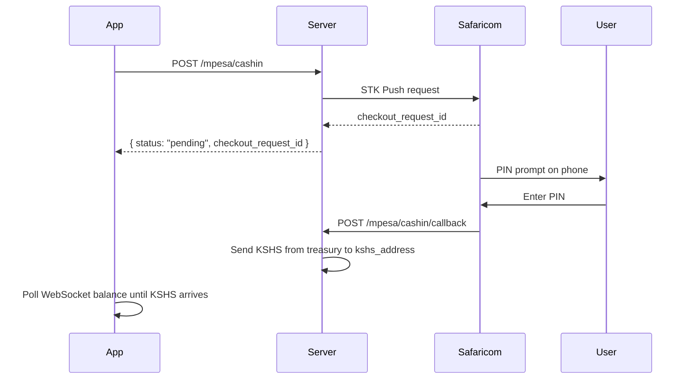
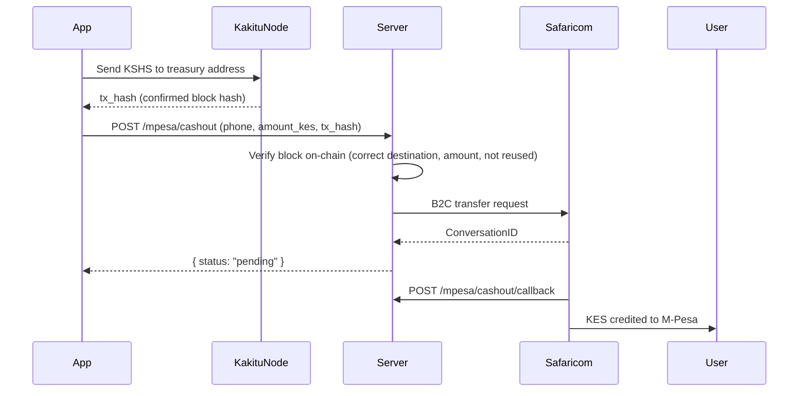

# M-Pesa Integration

Kakitu supports M-Pesa cash-in (KES → KSHS) and cash-out (KSHS → KES) via the Safaricom Daraja API.

## Cash-in (KES → KSHS)

The user pays KES via M-Pesa STK Push and receives KSHS at their wallet address.



### Request

```bash
curl -X POST https://walletapi.kakitu.africa/mpesa/cashin \
  -H "Content-Type: application/json" \
  -d '{
    "phone": "0712345678",
    "amount_kes": "100",
    "kshs_address": "kshs_1abc123..."
  }'
```

**Phone formats accepted:** `07XXXXXXXX` · `2547XXXXXXXX` · `+2547XXXXXXXX`

### Response

```json
{
  "status": "pending",
  "checkout_request_id": "ws_CO_12032026123456789"
}
```

### Detecting completion

Connect to the WebSocket and subscribe to your account. When KSHS arrives, you will receive a block notification:

```js
ws.onmessage = (event) => {
  const msg = JSON.parse(event.data);
  if (msg.account && msg.amount) {
    // Incoming KSHS block — refresh balance
  }
};
```

---

## Cash-out (KSHS → KES)

The user sends KSHS to the treasury address on-chain, then calls the cashout endpoint with the transaction hash.



### Step 1 — Get the treasury address

```bash
curl https://walletapi.kakitu.africa/mpesa/config
```

Response:
```json
{ "treasury_address": "kshs_1treasury..." }
```

### Step 2 — Send KSHS on-chain

Use your wallet to send exactly `amount_kes` KSHS to the treasury address. Wait for confirmation and note the block hash.

### Step 3 — Request cash-out

```bash
curl -X POST https://walletapi.kakitu.africa/mpesa/cashout \
  -H "Content-Type: application/json" \
  -d '{
    "phone": "0712345678",
    "amount_kes": "100",
    "tx_hash": "ABC123DEF456..."
  }'
```

Response:
```json
{ "status": "pending" }
```

### Validations

The server verifies before sending KES:
- Block exists and is confirmed on-chain
- Block destination = treasury address
- Block subtype = `send`
- Block amount matches `amount_kes` (1 KES = 1 KSHS)
- `tx_hash` has not been used before (double-spend protection)

---

## Sandbox

Set `MPESA_ENVIRONMENT=sandbox` on the server to use Safaricom's test environment (shortcode `174379`). Callbacks from Safaricom in sandbox mode are simulated and may not reflect real payment completion.
